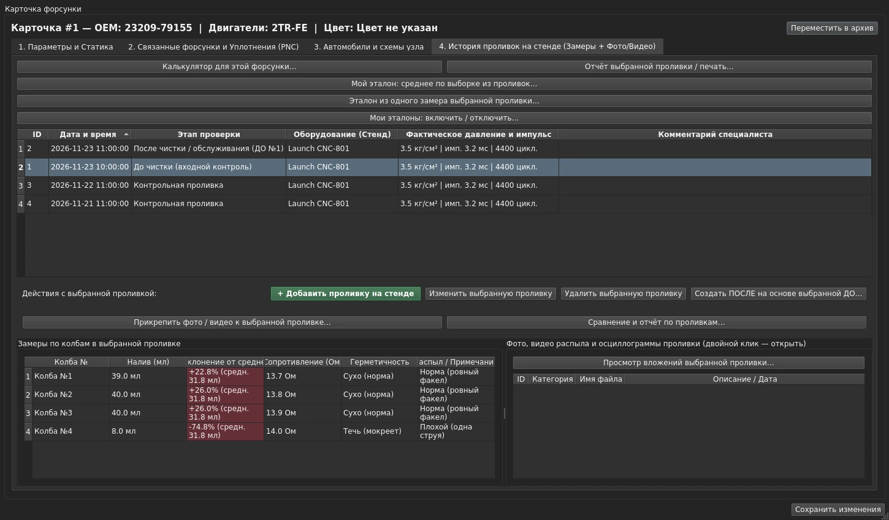
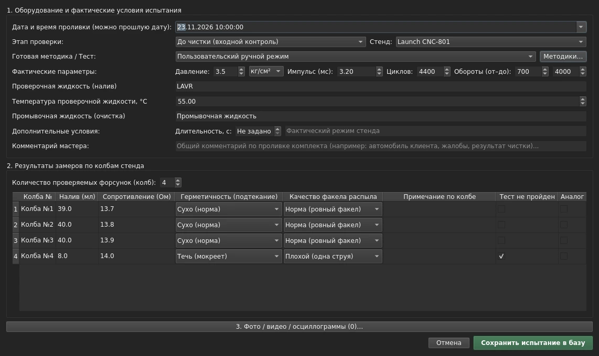
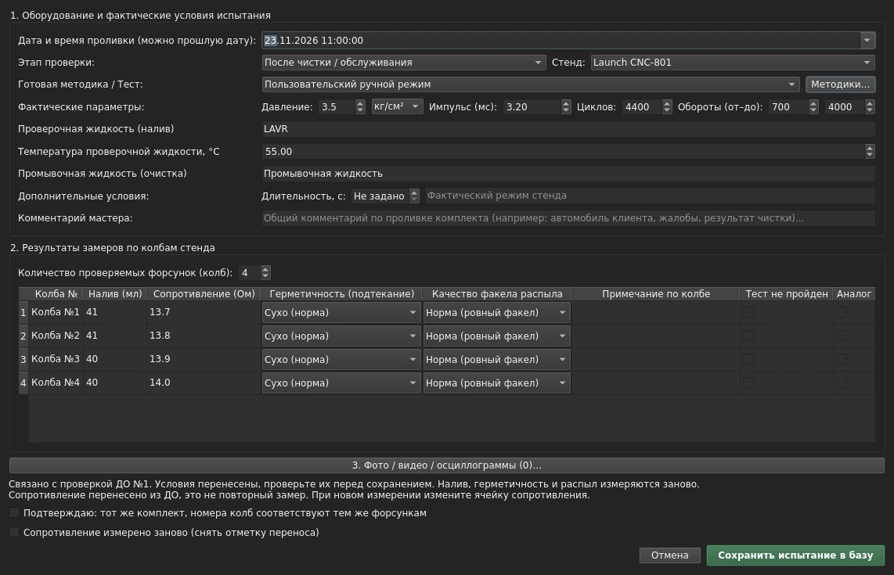
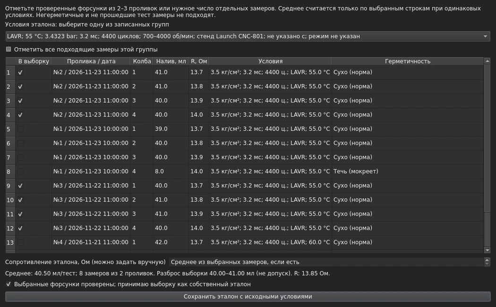
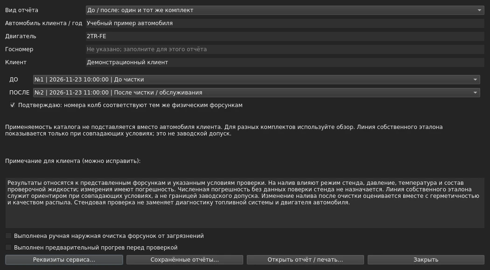
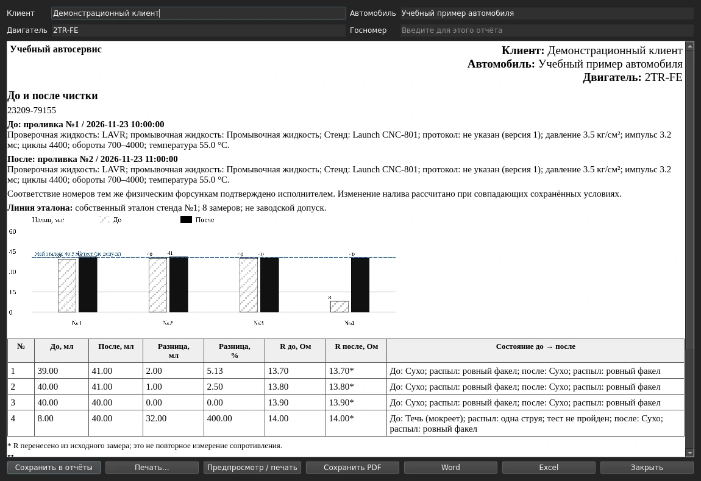
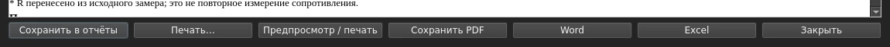

# Как работать с проливками и отчётами

Короткая инструкция для Injector Catalog Stable 1.0.15. Один рабочий цикл: **проверка ДО → проверка ПОСЛЕ → свой эталон → отчёт клиенту**.

На скринах учебная база. Числа, жидкость и режим показаны для объяснения интерфейса, а не как нормы или методика проверки конкретной форсунки. Оформление окон на Windows может немного отличаться.

[Скачать инструкцию в PDF](InjectorCatalog_Quick_Start_1.0.15.pdf) · [Скачать программу](https://github.com/Bekren3v/InjectorCatalog-Releases/releases/latest)

## Где находятся нужные кнопки

Найдите форсунку в каталоге, откройте карточку двойным щелчком и перейдите на вкладку **4. История проливок на стенде**. Список проливок находится в центре. Кнопки добавления, изменения и создания ПОСЛЕ расположены **под списком**. Кнопки эталонов находятся над ним.

## 1 Записать проверку ДО

1. Нажмите **+ Добавить проливку на стенде**.
2. Выберите **До чистки (входной контроль)**. Укажите фактическую дату и время: старые записи тоже можно внести.
3. Выберите стенд и методику либо ручной режим. Проверьте давление и единицы, импульс, циклы, обороты, название проверочной жидкости и её температуру. Промывочная жидкость указывается отдельно. Для изменения списка методик есть кнопка **Методики…**.
4. Укажите число форсунок. По каждой колбе внесите налив в **мл за этот тест**, сопротивление, герметичность и качество распыла. Пустой налив означает отсутствие замера; измеренный ноль записывайте как 0.
5. Если форсунка является аналогом, поставьте **Аналог** в её строке. При непрохождении проверки отметьте **Тест не пройден**. При необходимости прикрепите материалы кнопкой **3. Фото / видео / осциллограммы**.
6. Нажмите **Сохранить испытание в базу**. Запись появится в истории.

Сопротивление заполняйте по измерению. Если его нет, оставьте поле пустым. Налив в мл за тест и статический расход в см³/мин обозначают разные величины.

## 2 Создать связанную проверку ПОСЛЕ

1. В истории выделите нужную запись **ДО**.
2. Под списком нажмите **Создать ПОСЛЕ на основе выбранной ДО…**.
3. Проверьте перенесённые условия и дату. Налив, герметичность и распыл внесите заново по результатам повторной проверки.
4. Сопротивление переносится с отметкой, что это исходное измерение. Если измерили заново, измените значение либо поставьте **Сопротивление измерено заново (снять отметку переноса)**.
5. Внизу подтвердите, что это тот же комплект и номера колб относятся к тем же физическим форсункам. Затем сохраните испытание.

Номер колбы должен обозначать одну и ту же форсунку в обеих проверках. Если комплект заменён другим, используйте отдельные записи и режим обзора, а не расчёт улучшения одного комплекта. Отметка **Аналог** переносится в связанную проверку ПОСЛЕ.

## 3 Сохранить свой эталон

Свой эталон хранит среднее по выбранным проверенным замерам при одних условиях. Его можно использовать как ориентир своего стенда; заводским допуском он не становится.

1. Нажмите **Мой эталон: среднее по выборке из проливок…**.
2. В верхнем выпадающем списке выберите **одну группу условий**. Например, LAVR при 55 °C. Замеры при 60 °C находятся в другой группе.
3. Отметьте проверенные колбы из нужных проливок. Общий флажок выбирает все подходящие строки текущей группы; лишние снимите вручную.
4. Негерметичные и не прошедшие тест замеры недоступны. Строки с другими условиями тоже нельзя включить в эту группу.
5. Проверьте средний налив, число замеров и сопротивление под таблицей. Сопротивление можно задать вручную; без ручного значения используется среднее из выбранных измерений, если они есть.
6. Подтвердите выборку и нажмите **Сохранить эталон с исходными условиями**.

В примере отмечено 8 замеров из двух проливок: среднее 40,50 мл/тест. Это учебное значение, не рекомендация для указанного OEM.

**Если часть условий неизвестна**, сохраните их как есть. Программа не изменит исходные проливки, но эталон с неполными условиями не будет автоматически подставляться в расчёты. Температуры измерения сопротивления в этой форме нет; температура в группе относится к проверочной жидкости.

**Мои эталоны: включить / отключить…** управляет использованием сохранённых ориентиров. Отключение не удаляет их историю. Если эталон не применяется, проверьте его состояние и совпадение условий. Чтобы изменить исходные условия проливки, используйте **Изменить выбранную проливку**, а не поле подмены в эталоне.

## 4 Сравнить и выдать отчёт

1. В истории нажмите **Сравнение и отчёт по проливкам…**.
2. Для одного комплекта выберите **До / после: один и тот же комплект**, нужные записи ДО и ПОСЛЕ и подтвердите соответствие колб. Для нескольких комплектов выберите **Обзор нескольких проливок / комплектов** и отметьте записи для отчёта.
3. Заполните автомобиль, двигатель, госномер и клиента. Пустые поля клиента, автомобиля и госномера не печатаются. Если двигатель не введён, показываются связанные двигатели карточки с подписью **Двигатель по каталогу**.
4. Исправьте примечание при необходимости. Флажки ручной наружной очистки и прогрева ставьте только для фактически выполненных процедур. Кнопка **Реквизиты сервиса…** открывает настройки шапки, логотипа и подписи.
5. Нажмите **Открыть отчёт / печать…** и проверьте результат.

Линия собственного эталона появляется на графике при совпадении условий. В парном отчёте один эталон должен подходить обеим проливкам. Если линия отсутствует, программа пишет причину. Разница налива и процент рассчитываются только при сопоставимых условиях и подтверждённом соответствии форсунок. При исходном нуле процент не определяется.

### Как сохранить и открыть позже

- **Сохранить в отчёты** сохраняет снимок отчёта в базе. Повторно открыть: **Документы → Сохранённые отчёты сравнения…**. Само сохранение PDF не создаёт запись в этом списке.
- **Сохранить PDF** создаёт файл для отправки или печати.
- **Word** и **Excel** сохраняют редактируемые текст и таблицы. График остаётся изображением и не пересчитывается при правке чисел в файле.
- **Предпросмотр / печать** открывает редактор печатной копии. Правки там не меняют исходные замеры. Экспорт исправленной копии выполняйте кнопками внутри этого редактора.

Обычный отчёт на четыре форсунки рассчитан на лицевую и оборотную стороны A4: замеры спереди, примечание и реквизиты с подписью с оборота. Для печати на одном физическом листе выберите двустороннюю печать с переворотом по длинному краю, если принтер её поддерживает. Длинные отчёты могут занимать больше двух страниц.

## Перед обновлением или переносом

Создайте ZIP через **Настройки → База данных → Сохранить базу / перенос / облачная папка…** и сохраните его отдельно. Перед установкой обновления закройте программу. Устанавливайте в прежнюю папку; не заменяйте рабочую базу базой из чужого архива.
